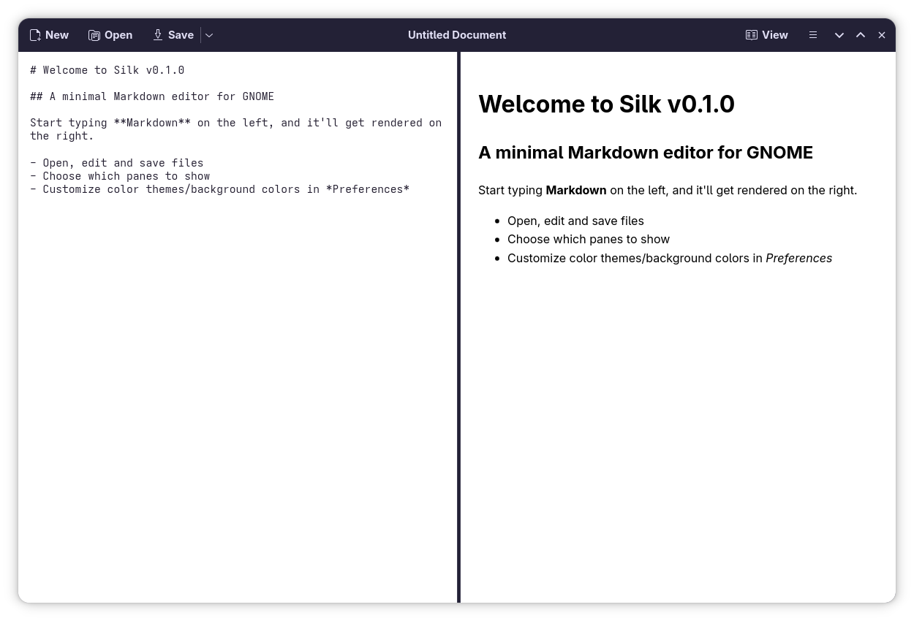
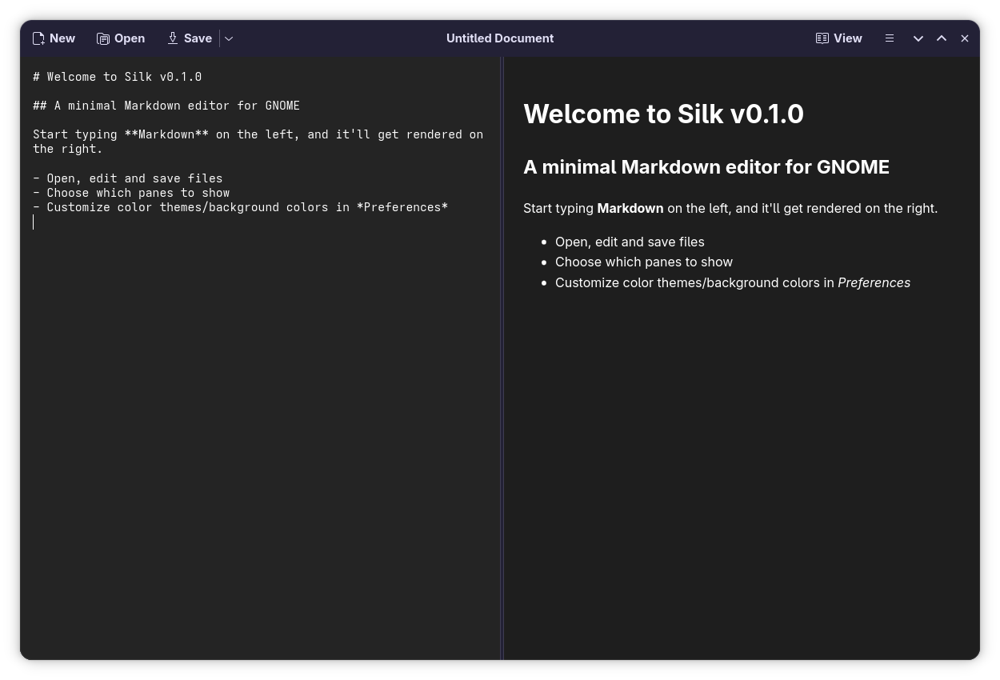
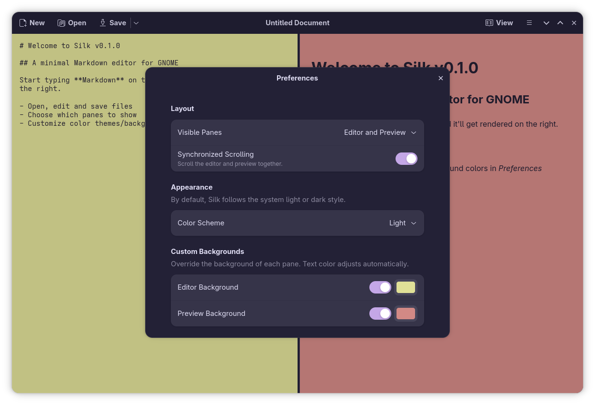
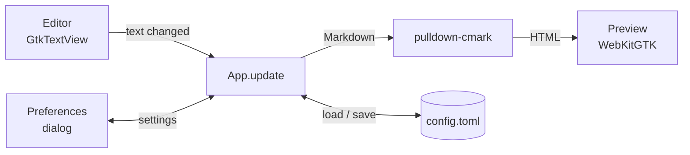

<!-- markdownlint-disable MD033 -->
<!-- markdownlint-disable MD041 -->
<p align="left">

</p>
<!-- markdownlint-enable MD041 -->

<a href="https://github.com/richbl/rust-silk/releases"></a>
<a href="https://github.com/richbl/rust-silk/pulls?q=is%3Apr+state%3Aclosed"></a>
<a href="https://rust-reportcard.xuri.me/report/github.com/richbl/rust-silk"></a>
<a href="https://app.codacy.com/gh/richbl/rust-silk/dashboard?utm_source=gh&utm_medium=referral&utm_content=&utm_campaign=Badge_grade"></a>
<!-- <a href="https://sonarcloud.io/summary/new_code?id=richbl_rust-silk"></a> -->

<!-- <a href="https://codeberg.org/richbl/rust-silk"></a> -->
<!-- markdownlint-enable MD033 -->

**Silk** **is a minimal Markdown editor/viewer for GNOME, written in Rust**

## About

**Silk** is just that: a minimal Markdown editor/viewer. Nothing fancy. One window for Markdown editing, and another for a rendered Markdown preview. You decide which one you want to use, or use them both.

Lightweight. Quick and simple. Done.

I originally had planned to call this project **My Own Minimal Markdown Editor**, or **MOMME** and then discovered that "momme" is a unit of measure for... silk (read more here about [momme](https://en.wikipedia.org/wiki/Units_of_textile_measurement#Momme)). Hence the odd but relevant origin of the **Silk** project name.

### Motivation

Many Markdown editors are either bare text boxes with no preview or heavyweight tools with far more features than a quick note or README needs. **Silk** aims for the space in between: a configurable focused editor with a live preview, sensible defaults, and nothing in the way.

It's also a practical exercise in building a modern, idiomatic [GTK4](https://docs.gtk.org/gtk4/)/[Libadwaita](https://gnome.pages.gitlab.gnome.org/libadwaita/doc/1-latest/) application using the [Relm4](https://relm4.org/) GUI framework in Rust.

### Silk in Action

<!-- markdownlint-disable MD033 -->

<p align="center">

</p>

<p align="center">

</p>

<p align="center">

</p>

<!-- markdownlint-enable MD033 -->

## Features

* **Live Markdown Preview**
  * The rendered Markdown preview window updates as you type
* **Flexible Window Layout**
  * Show the editor and preview windows side by side, or show just one of them
* **Synchronized Scrolling**
  * Optionally, keep the editor and preview windows synchronized while you scroll through a file
* **Rich Markdown**
  * Based on [CommonMark](https://commonmark.org/),  which includes tables, strike-throughs, task lists and footnotes
* **Light, Dark or System Color Themes**
  * Quickly toggle through light/dark theme options or follow your system's color theme
* **Custom Backgrounds**
  * Set custom color backgrounds for both the editor and preview windows
* **Remembers Your Configuration**
  * Window size, maximized and fullscreen state, and application preferences persist between sessions
* **Safe, Sandboxed Preview Window**
  * Scripts, remote stylesheets, frames and network access are blocked inside the preview window in compliance with [Content-Security-Policy (CSP)](https://en.wikipedia.org/wiki/Content_Security_Policy) standards

## How Silk Works

### It's a Minimal Markdown Editor

**Silk** is simple. It's an editor window and a preview window for managing Markdown documents, and some options to customize the application.

### Under the Covers

**Silk** is a [Relm4](https://relm4.org/) application, which follows an Elm-style communications architecture:

``` text
The UI sends messages, a single `update` function changes the application state, and the view is derived from that state.
```

The diagram below shows how this Elm-style architecture is used in **Silk**:



## Installation

**Silk** includes its own installer/uninstaller built directly into the `silk-markdown-editor` binary file. This binary file is available in each GitHub release.

To install **Silk**, run the following command:

```text
silk-markdown-editor --install
```

Everything is installed for the current user (no root access needed):

| Item | Location |
| ------ | ---------- |
| `silk-markdown-editor` binary | `~/.local/bin` |
| Desktop entry (`io.github.richbl.Silk.desktop`) | `~/.local/share/applications` |
| Icon (`io.github.richbl.Silk.svg`) | `~/.local/share/icons/hicolor/scalable/apps` |

The installer honors `XDG_BIN_HOME` and `XDG_DATA_HOME` if set, and warns if the bin directory is not on your `PATH`.

### Uninstalling Silk

To remove **Silk**:

```text
silk-markdown-editor --uninstall
```

> **Note:** Your **Silk** configuration file is intentionally not removed during the uninstallation process. You must manually remove it from `~/.config/silk/config.toml`.

### Building Silk from Source

#### Installing Build Dependencies

Building **Silk** requires:

* Rust 1.95 or later
* Cargo (included with the Rust toolchain)
* GTK4 development libraries
* Libadwaita development libraries (version 1.5 or later)
* WebKit for GTK4 development libraries
* The `pkg-config` package
* The `glib2-devel` package

##### Fedora

```text
sudo dnf install gcc pkgconf-pkg-config glib2-devel gtk4-devel libadwaita-devel webkitgtk6.0-devel
```

##### Debian/Ubuntu

```text
sudo apt install build-essential pkg-config libglib2.0-dev-bin libgtk-4-dev libadwaita-1-dev libwebkitgtk-6.0-dev
```

#### Compiling the Silk Repository

Download, clone the **Silk** repository, and compile the application:

```text
git clone https://github.com/richbl/rust-silk.git
cd rust-silk
cargo build --release
```

The resulting executable is located in `target/release/`:

```text
target/release/
└── silk-markdown-editor
```

Once the **Silk** binary is built, you can optionally run the test suite and/or Rust linter (`clippy`):

```text
cargo test --all-features
cargo clippy --all-features
```

## Silk Usage

**Silk** runs as a stand-alone GTK4/libadwaita application:

```text
silk-markdown-editor
```

or launch **Silk** from your desktop environment's application launcher.

When run from a terminal, these options are also available:

| Option | Description |
| --- | --- |
| `-h`, `--help` | Print command-line help |
| `-i`, `--install` | Install Silk for the current user |
| `-u`, `--uninstall` | Remove Silk for the current user |

The GUI provides graphical controls for file management, a live view of the Markdown editor and preview windows, and automatic saving of configuration preferences.

### The Header Bar

| Control | What it does |
| --- | --- |
| **New** | Start a new, empty document |
| **Open** | Open a Markdown file (`.md` or `.markdown`; other files can be shown with the "All Files" filter) |
| **Save** | Save the document. The drop-arrow beside it offers **Save As…** |
| **View Options** | Choose the window display layout (`Editor Only`, `Preview Only`, or `Editor and Preview`) and the color scheme (`Light`, `Dark`, or `Follow System`) |
| **Main Menu** | Open **Preferences** or the **About** dialog |

### Unsaved File Changes

A `•` before the file name in the title bar means the document has unsaved changes. `Save` is available when there are changes to save, or when the document has never been saved. `Save As...` is always available. If you create a new document, open another file or close the window with unsaved changes, Silk asks whether to **Save**, **Discard** or **Cancel**.

### Preferences Dialog

* **Visible Panes**
  * `Editor Only`, `Preview Only`, or `Editor and Preview`
* **Synchronized Scrolling**
  * A toggle option to scroll the editor and preview windows together
* **Color Scheme**
  * `Light`, `Dark`, or `Follow System`
* **Editor Background** and **Preview Background**
  * Switch to a custom background color for each display window

### Keyboard Shortcuts

| Shortcut | Action |
| --- | --- |
| `Ctrl`+`N` | New document |
| `Ctrl`+`O` | Open a file |
| `Ctrl`+`S` | Save |
| `Ctrl`+`Shift`+`S` | Save As |
| `Ctrl`+`,` | **Preferences** dialog |
| `Ctrl`+`W` or `Ctrl`+`Q` | Close the application |

## Configuration

Everything in the **Preferences** dialog and the **View** menu is stored in a TOML file at:

```text
$XDG_CONFIG_HOME/silk/config.toml
```

which is normally `~/.config/silk/config.toml`. **Silk** creates this configuration file the first time an application setting changes.

| Key | Values | Description |
| --- | --- | --- |
| `view_mode` | `"both"` (default), `"editor-only"`, `"preview-only"` | Which panes are visible |
| `color_scheme` | `"system"` (default), `"light"`, `"dark"` | Overall light or dark style based on the desktop environment |
| `sync_scroll` | `true` or `false` | Keep the editor and preview scrolled together |
| `editor_background` | a color string | Custom editor background color |
| `preview_background` | a color string | Custom preview background color |
| `[window]` `width`, `height` | integers (pixels) | Window size. Defaults to 1200 × 800 |
| `[window]` `maximized`, `fullscreened` | `true` or `false` | Window state |

### Background Colors

Colors can be any color string GTK understands, such as `"#1e1e2e"`, `"rgb(30,30,46)"` or a CSS color name like `"tomato"`. The **Preferences** dialog writes colors in the `rgb(r,g,b)` form.

### Configuration File Example

```toml
# Silk Configuration (TOML)
# v0.1.0

view_mode = "both"
color_scheme = "dark"
editor_background = "rgb(224,224,151)"
preview_background = "rgb(210,137,133)"
sync_scroll = true

[window]
width = 1200
height = 800
maximized = false
fullscreened = false
```

## Roadmap

While the intent of the project is to remain minimal, here are some ideas about possible additional features:

* [ ] Flatpak packaging
* [ ] Recent files list
* [ ] Find and replace
* [ ] Export to HTML and PDF
* [ ] Syntax highlighting in the editor
* [ ] Line numbers

What else should **Silk** do?

## Contributing

Feature requests and bug reports are welcome on the [issue tracker](https://github.com/richbl/rust-silk/issues/new?template=issue-report.md).

## License

**Silk** is open-source software distributed under the [MIT License](LICENSE).
